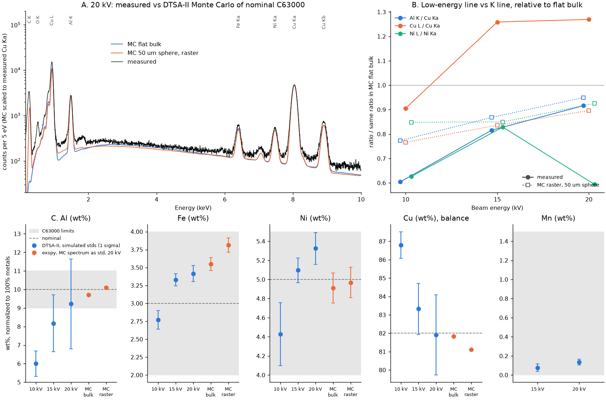
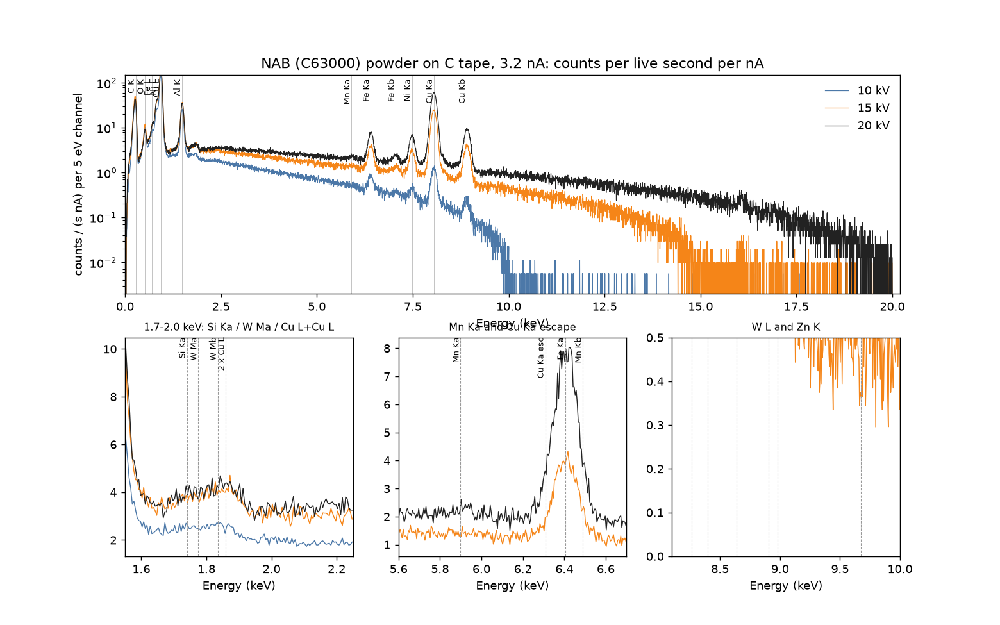

# EDS of the first NAB (C63000) powder: DTSA-II quantification, Monte Carlo and acquisition advice

Issue #27. The powder is code `k7m2q9`: wrought 630 bronze rod (UNS C63000, a nickel-aluminum bronze,
nominally 82Cu-10Al-5Ni-3Fe), ultrasonically atomized on Oct 27, 2026. The SEM/EDS session was the same
day on the BYU Apreo C with an EDAX Octane Plus (TEAM 4.5.1). The powder was on carbon tape.

**Provenance.** The data come from `sgbaird/agent-staging` at commit `3c25afa`, folder
`for/vertical-cloud-lab/caliber/2026-10-28-nab-c63000-sem-eds/`. All 20 files matched the sha256 list in
the drop's `MANIFEST.md`. The raw spectra and images are not committed here; `fetch_data.sh` fetches
and checks them. Everything below is derived from the three `.msa` spectra (10, 15 and 20 kV at
3.2 nA), the `.spc` headers and the TIFF metadata.

## Results in brief

| wt%, normalized to 100% metals | Al | Fe | Ni | Mn | Cu |
|---|---|---|---|---|---|
| C63000 limits | 9.0–11.0 | 2.0–4.0 | 4.0–5.5 | ≤ 1.5 | balance |
| Nominal (also the Monte Carlo input) | 10 | 3 | 5 | – | 82 |
| **Measured, 20 kV, DTSA-II** (K lines) | **9.2 ± 2.4** | **3.42 ± 0.11** | **5.33 ± 0.17** | **0.14 ± 0.03** | **81.9 ± 2.2** |
| Measured, 15 kV, DTSA-II (K lines) | 8.2 ± 1.5 | 3.33 ± 0.08 | 5.10 ± 0.13 | 0.08 ± 0.04 | 83.3 ± 1.4 |
| Measured, 10 kV, DTSA-II (K lines) | 6.0 ± 0.7 | 2.77 ± 0.13 | 4.43 ± 0.33 | n.d. | 86.8 ± 0.7 |
| Measured, 20 kV, exspy fit, MC flat bulk as standard | 9.70 ± 0.07 | 3.55 ± 0.09 | 4.91 ± 0.16 | – | 81.8 |
| Measured, 20 kV, exspy fit, MC raster over a sphere as standard | 10.10 ± 0.07 | 3.81 ± 0.10 | 4.97 ± 0.16 | – | 81.1 |
| Simulated: MC flat bulk, 20 kV, through DTSA-II | 10.03 ± 0.78 | 2.91 ± 0.04 | 4.97 ± 0.06 | – | 82.1 ± 0.7 |
| Simulated: MC 50 µm sphere on C, beam on top, 20 kV | 10.20 ± 0.81 | 2.81 ± 0.04 | 4.90 ± 0.06 | – | 82.1 ± 0.7 |
| Simulated: MC raster over a 50 µm sphere on C, 20 kV | 9.65 ± 1.19 | 2.72 ± 0.05 | 4.87 ± 0.08 | – | 82.8 ± 1.1 |
| Simulated: same raster, 15 kV / 10 kV | 8.71 / 7.44 | 2.76 / 2.83 | 4.93 / 4.86 | – | 83.6 / 84.9 |

Uncertainties are 1σ. DTSA-II's include counting statistics and its matrix-correction model (mostly the
mass absorption coefficient of Al Kα in Cu, which is why Al carries ±2.4 wt% at 20 kV although its k-ratio
is good to 0.9%). The exspy uncertainties are counting only. None of them include the error from the rough
powder geometry or from the standardless (simulated-standard) approach; see below.

- **The powder is C63000 within the measurement's reach.** At 15 and 20 kV, Al, Fe, Ni and Mn all sit
  inside the C63000 limits. The two independent routes agree: DTSA-II's filter fit with XPP, and exspy
  Gaussian fits with the Monte Carlo spectrum as a matrix-matched standard. At 15–20 kV, Fe reads 0.3–0.8 wt%
  above nominal in every route, still inside 2.0–4.0. Mn is present at about 0.1 wt%.
- **No tungsten from the W-dipped plate is detected.** W Mα (1.775 keV) fits to k = 0.00005 ± 0.00013 at
  20 kV, which puts W below roughly 0.2 wt% (3σ). The clean W Lβ1 window (9.67 keV) is empty at 15 and
  20 kV. The bump next to Al K is a **pile-up peak** (two L-complex photons, 2 × ≈0.91 keV), not W M or Si:
  its centroid is 1.82–1.83 keV, it is 140–160 eV wide, and its area scales with the square of the Cu L
  count rate across the three spectra (area / (rate² × live time) = 8.5, 8.7 and 9.7 × 10⁻⁷ s). Si
  (< 0.1 wt%) and Zn (< 0.25 wt%) are not detected. O is present at every voltage (surface oxide, maybe tape
  adhesive), and the large C K peak is the carbon tape.
- **The loose spherical powder costs accuracy, most for the low-energy lines.** On a particle top the
  geometry is effectively bulk: the 50 and 100 µm sphere simulations reproduce flat bulk within a few percent. Rastering
  over a 50 µm sphere on carbon is different. Shadowed and tilted facets absorb Al K (1.49 keV) and the L lines
  (0.7–0.93 keV) far more than the K lines at 6–9 keV, so Al reads 0.4 wt% low at 20 kV, 1.1 at 15 kV and
  1.8 at 10 kV. The measured Al K / Cu Kα ratio follows that raster trend within 3–6% at 15 and 20 kV.
  This geometry, and not a real composition change, is the most likely reason Al falls from 9.2 to 6.0 wt%
  between 20 and 10 kV. The absolute intensities agree: the measured analytical totals are 30–39%, a raster
  over one sphere gives 65–70%, and flat bulk gives 100–102%.
- **The L lines don't agree with the K lines and shouldn't be used for this alloy.** Relative to the
  flat-bulk simulation, the measured Cu L / Cu Kα is 1.26–1.27 at 15–20 kV while Ni L / Ni Kα is 0.59–0.83.
  Fe L, Ni L and Cu L sit within 230 eV of each other, so how the L complex is split depends on line-weight
  and detector-efficiency models below 1 keV. L-line compositions carry DTSA-II uncertainties of ±2–9 wt%
  (table in `outputs/dtsa2_quant.csv`).
- **Acquisition, in CALIBER's parameters:** polished cross-sections, **20 kV** (15 kV as a second setting),
  **1.3–2.0 nA** for 20–30% dead time, **100–200 s live time** per spectrum, ≥ 10 locations per lot, and
  measured pure-element standards plus a polished feedstock-rod coupon in the same session. Details in §4.



## 1. Peak identification



- **Energy scale.** Centroids of Al Kα, Fe Kα, Ni Kα, Cu Kα and Cu Kβ sit 5–11 eV above their reference
  energies (C K sits 11–14 eV below, as is usual for an SDD). Left alone, this leaves derivative-shaped fit
  residuals on every major peak and pushes Fe Kα counts into the Mn Kβ fit. A first pass that took Mn from
  its Kβ ROI read "2.3 wt% Mn" this way. Each spectrum gets its own linear correction: offset 1.4 / 4.2 / 5.8 eV and gain +0.13 / +0.06 /
  +0.07% at 10 / 15 / 20 kV (`outputs/energy_calibration.csv`). The resolution in the header (127.9 eV at
  Mn Kα) matches the measured widths: 147–149 eV at Cu Kα and 75–76 eV at Al Kα.
- **Found:** C K (tape), O K, Fe L, Ni L, Cu L, Al K, Fe Kα/Kβ, Ni Kα/Kβ, Cu Kα/Kβ, and Mn Kα at trace level.
  Mn Kα has 394 net counts at 20 kV against a 3σ of 201, and k = 0.00046 ± 0.00010, which gives 0.14 ± 0.03 wt%.
- **W:** not detected (see above). DTSA-II does put some intensity into the W Lα ROI (k = 0.0066 at 15 kV,
  0.0015 at 20 kV). That intensity is larger at the lower voltage, the opposite of how W L would be excited,
  and W Lβ1 is absent, so it is overlap: the Ni Kβ / Cu Kα tail, plus probably Cu Kα + C K pile-up at 8.33 keV.
- **Sum (pile-up) peaks, all present:** L + L at 1.82 keV; Cu Kα + Cu Kα at 16.09 keV (254 net counts against
  a 3σ of 70 at 20 kV; at 15 kV it sits above E0); Al K + Cu L at 2.42 keV (3–6σ); and probably Cu Kα + Cu L
  at 8.98 keV, which shows as excess on the high side of Cu Kβ in the residuals. They are a sign of high
  count rate (below).
- **Escape peaks:** not resolved. The Reed–Ware estimate for Si escape from Cu Kα in a 0.45 mm SDD is about
  0.18% of the parent, or about 180 counts at 6.31 keV at 20 kV against 13,400 Fe Kα counts. That is at most
  a 1.5% relative (0.05 wt%) effect on Fe. Neither DTSA-II nor exspy models escape peaks.
- **Count rate and dead time.** Each spectrum holds about 1.02 M counts. Output rates were 18.4 / 32.3 / 41.7
  kcps at 10 / 15 / 20 kV and 3.2 nA. Real time is not in the files, so dead time can only be bracketed:
  15 / 30 / 43% under a paralyzable model with τ = the 7.68 µs amp time, or 32 / 50 / 59% if the `.spc`
  "preset" field (81 / 63 / 60 s) is clock time. Either way, 20 kV at 3.2 nA ran hot.

## 2. DTSA-II quantification (simulated standards)

DTSA-II has no "standardless" button, so the standards were simulated. For each beam energy, DTSA-II's
analytical simulator made pure-element spectra (O from Al2O3) with the same detector model. The unknown
was filter-fit against them, giving k-ratios for every line family, and the metal k-ratios went through
XPP. C and O were fit but kept out of the matrix correction. The detector model comes from the `.spc`
headers: 4096 × 5 eV, 127.9 eV, elevation 35°, 40 nm Al, 0.085 µm dead layer, 0.45 mm Si. The sample at
WD 10.89 mm, against a 10.00 mm intersection, gives TEAM's 36.03° take-off angle and implies about 40 mm
to the detector. **Assumed:** 30 mm² area and a Moxtek AP3.3 polymer window. The window matters for
Al K and the L lines, not for the K lines of Fe, Ni or Cu.

The full table, with raw (un-normalized) values, analytical totals and the L-line sets, is
`outputs/dtsa2_quant.csv`. Every fitted line's k-ratio is in `outputs/dtsa2_kratios.csv`. A summary:

| Measured, line set | Al | Fe | Ni | Mn | Cu | Analytical total |
|---|---|---|---|---|---|---|
| 20 kV, K lines | 9.22 ± 2.42 | 3.42 ± 0.11 | 5.33 ± 0.17 | 0.14 ± 0.03 | 81.91 ± 2.18 | 30.3% |
| 20 kV, L lines for Fe/Ni/Cu | 8.29 ± 2.96 | 2.10 ± 4.06 | 2.96 ± 4.54 | – | 86.64 ± 6.60 | 34.1% |
| 15 kV, K lines | 8.18 ± 1.53 | 3.33 ± 0.08 | 5.10 ± 0.13 | 0.08 ± 0.04 | 83.32 ± 1.40 | 34.3% |
| 15 kV, L lines for Fe/Ni/Cu | 7.11 ± 1.65 | 2.08 ± 3.02 | 3.81 ± 3.71 | – | 87.00 ± 4.82 | 39.8% |
| 10 kV, K lines (Cu K at U = 1.11) | 6.00 ± 0.68 | 2.77 ± 0.13 | 4.43 ± 0.33 | n.d. | 86.80 ± 0.72 | 39.3% |
| 10 kV, Fe K + Ni L + Cu L | 6.98 ± 1.15 | 3.25 ± 0.36 | 3.21 ± 2.28 | – | 86.57 ± 2.56 | 33.7% |

**What the rough, spherical, 30–180 µm particles on carbon do to accuracy.** Each particle is far larger
than the X-ray source (generation depth 0.4–1.3 µm), so particle size itself doesn't matter. Surface
orientation does. On facets turned away from the detector the X-rays leave through more metal, or not at
all, and the flat-sample matrix correction knows nothing about it. That loss is strongly energy dependent.
The simulated raster puts it at 5–23% for Al K / Cu Kα and 10–23% for Cu L / Cu Kα, against 7% for
Fe Kα / Cu Kα and 3–10% for Ni Kα / Cu Kα. Normalizing to 100% hides the overall loss but not this energy dependence, so Al and every
L line come out low by an amount that changes with kV and from particle to particle. Tape in the beam adds
C K and continuum but no metal lines. A flat polished section removes all of this: XPP then applies as
intended, and the analytical total becomes a useful check (it is meaningless here, at 30–39%). The
standardless part remains on top of that. Newbury ([1998, *Microsc. Microanal.* 4](https://www.nist.gov/node/760856))
found 95% of standards-based EDS analyses on flat samples within ±5% relative, against ±25% (fitted
standards) to ±50% (first-principles) for standardless analysis. These results agree with nominal much
better than ±25%, but that agreement can't be counted on for Al without real standards.

## 3. Monte Carlo (DTSA-II NISTMonte, Gen 3)

Nominal C63000 (82Cu-10Al-5Ni-3Fe wt%, 7.58 g/cm³) at 10, 15 and 20 kV, simulated with characteristic and
continuum secondary fluorescence and at the same dose as each measurement (3.2 nA × live time). There are
four geometries: flat bulk; 50 and 100 µm spheres on carbon (1.8 g/cm³) with the beam on the top centre;
and a raster over the 2R × 2R square around a 50 µm sphere on carbon (a 10 × 5 grid of beam positions,
using symmetry in y). The flat-bulk and sphere-top runs use 3000 trajectories; the raster uses 240 per
position. The spectra are in `outputs/mc/` and go through exactly the same DTSA-II steps as the measured
ones.

- **The quantification chain is self-consistent.** DTSA-II recovers 10.03 / 2.91 / 4.97 / 82.08 from the
  flat-bulk MC spectrum at 20 kV, and 9.78 / 2.93 / 5.02 / 82.26 at 15 kV. At 10 kV it returns 9.26 Al, so
  near the Cu K threshold the analytical model and the MC already disagree by about 0.7 wt% Al.
- **Sphere tops are bulk.** The sphere-top runs match flat bulk within about 3% on Al K and the K lines, and
  within 7% on the noisier L lines. The one sign of the finite particle is Fe K, which drops about 3% for
  the 50 µm sphere (less for 100 µm): Cu K → Fe K secondary fluorescence reaches tens of µm and is cut off
  by the sphere.
- **Low-energy lines against K lines** (`outputs/line_ratios_relative_to_mc_bulk.csv`; panel B of the
  figure; spectra overlaid in `figures/mc_vs_measured_spectra.png`):

| Ratio relative to MC flat bulk | 10 kV measured / MC raster | 15 kV measured / MC raster | 20 kV measured / MC raster |
|---|---|---|---|
| Al K / Cu Kα | 0.60 / 0.77 | 0.82 / 0.87 | 0.92 / 0.95 |
| Cu L / Cu Kα | 0.91 / 0.77 | 1.26 / 0.84 | 1.27 / 0.90 |
| Ni L / Ni Kα | 0.63 / 0.85 | 0.83 / 0.85 | 0.59 / 0.93 |
| Fe Kα / Cu Kα | 0.89 / 0.93 | 1.12 / 0.93 | 1.17 / 0.93 |
| Cu Kα intensity vs flat bulk | 0.41 / 0.71 | 0.35 / 0.66 | 0.30 / 0.64 |

  Al K follows the raster at 15–20 kV. The extra deficit at 10 kV (0.60 measured against 0.77 simulated)
  needs more than one isolated sphere can supply. Candidates are shadowing by neighbouring particles, a
  surface oxide or Al-depleted skin (at 10 kV, Cu K comes from the top 70 nm only), and the near-threshold
  Cu K excitation. Spot analyses on a polished section at 10 and 20 kV would tell these apart. The L-line
  ratios move in opposite directions for Cu and Ni, which points at how the overlapping L complex gets
  split, not at absorption. The measured Cu Kα intensity is 0.46–0.58 of the raster's. That shortfall is
  plausibly the detector solid angle (area assumed), the probe current (nominal, not measured with a
  Faraday cup) and a real field with more tape and shadowing than one sphere.

## 4. Acquisition advice in CALIBER's terms

The CALIBER outline frames EDX as minimizing (EDX − ICP-MS)² over beam energy {5, 10, 15, 20} kV,
acquisition time and beam current (20 pA to 10 nA). For this alloy:

| Parameter | Recommendation | Why (from these data) |
|---|---|---|
| Sample form | Polished cross-section of mounted powder, conductive mount; keep a loose-powder stub for morphology only | Geometry biases Al by −0.4 to −1.8 wt% and the L lines by 10–23%, and the bias depends on kV and particle (§2–3) |
| Beam energy | **20 kV** primary, 15 kV secondary; drop 5 and 10 kV for quantification | Overvoltage for Cu K is 2.23 at 20 kV and 1.67 at 15 kV, but only 1.11 at 10 kV (Ni K 1.20). At 10 kV Al came out 4 wt% low here, and 10 kV is the most surface-sensitive setting. At 5 kV there are no Fe/Ni/Cu K lines, only the overlapped L complex |
| Beam current | **1.3–2.0 nA at 20 kV** (2.0–3.2 nA at 15 kV), aiming at 20–30% dead time with the 7.68 µs amp time | 3.2 nA gave 42 kcps output (≈43% dead time) at 20 kV with L+L and Cu Kα+Cu Kα pile-up visible. Measure the current (Faraday cup) before and after each spectrum and record real time |
| Live time | **100–200 s** per spectrum at 1.5 nA (150–300 nA·s) | At 78 nA·s the k-ratios were good to 0.9% (Al K), 1.3% (Fe Kα, Ni Kα) and 0.3% (Cu Kα) relative, i.e. σ ≈ 0.09 Al, 0.04 Fe, 0.07 Ni wt%. 1% on Fe and Ni needs ≈ 130 nA·s at 20 kV and ≈ 350 nA·s at 15 kV |
| Repeats | ≥ 10 particles (or 20 × 20 µm areas inside particles) per lot, plus 3–5 on the feedstock | Counting statistics are not the limit; particle-to-particle and microstructural (κ-phase) spread is |
| Standards | Pure Cu, Al, Ni, Fe (and Mn), same session and settings; a polished, ICP-analyzed coupon of the feedstock rod as a matrix-matched check | Brings Al from ±2.4 wt% (DTSA-II's absorption-correction uncertainty, standardless) to about ±0.5 wt% (±5% relative, 95%, Newbury 1998) |
| Geometry | WD 10.9 mm (TOA 36°), stage untilted, same as this session | Keeps the detector model and the take-off angle fixed between lots |

**Will ±1 wt% for Al, Ni and Fe be reached?** For Fe and Ni, yes: counting statistics are already 0.04–0.17
wt%, and all 15–20 kV routes fall within Fe 3.3–3.8 and Ni 4.85–5.33. For Al, only with measured standards on
a flat sample. Standardless (simulated-standard) Al carries ±1.5–2.4 wt% of model uncertainty at 15–20 kV,
before any geometry error.

**Protocol for the next powder lots**

1. Split each lot: one loose-powder stub on C tape (morphology, size, satellites, surface patches), one
   hot-mounted, ground and polished cross-section (to 0.05 µm, or 1 µm diamond plus colloidal silica). If
   possible, put a slice of the feedstock rod in the same mount.
2. Same day and settings: 20 kV, 1.5 nA (adjust for 20–30% dead time), amp time 7.68 µs, WD 10.9 mm,
   150 s live time. Measure the probe current before and after, and save `.spc` + `.msa` with real time.
3. Acquire standards (Cu, Al, Ni, Fe, Mn) and the feedstock coupon under the same conditions.
4. Collect ≥ 10 particle-interior areas per lot, and 15 kV repeats on 3 of them.
5. Quantify with DTSA-II against the measured standards. Keep this repo's scripts for the energy-scale
   check, the pile-up/W/Mn checks and the simulated-standard comparison.
6. Send the feedstock rod and each lot for ICP-OES/MS. That is CALIBER's objective, and it settles Al
   loss during atomization (a 1300 °C melt with an oxidizable Al fraction).
7. On the loose-powder stub, spot-analyze the bright patches seen on the ~52 µm particle (`3.2nA.tif`)
   and the dark dendritic patch on the ~260 µm particle (`3.2nA_003.tif`) at 10 kV against clean surface.
   Al-rich oxide versus Cu-rich deposit should be easy to tell apart.

## 5. Cross-check with a second tool

HyperSpy 2.5 / exspy 0.3 fit Gaussian lines over a 6th-order polynomial background between 1.25 keV and
E0 (`outputs/exspy_intensities.csv`). This route then uses the MC spectrum of nominal C63000 as a
matrix-matched standard, C_X ∝ C_X,nominal × (I_X / I_Cu)_measured / (I_X / I_Cu)_MC. It shares no fitting
code and no matrix correction with the DTSA-II route. At 20 kV it gives Al 9.70, Fe 3.55, Ni 4.91, Cu 81.8
(MC bulk as standard) and Al 10.10, Fe 3.81, Ni 4.97, Cu 81.1 (MC raster as standard). Both agree with
DTSA-II within its uncertainties (`outputs/exspy_mc_standard_quant.csv`). With the raster as standard, the
spread of Al with kV shrinks from 6.7–9.7 to 8.3–10.1. The exspy fit also puts counts at W Mα (10 kV) and
W Lα in the MC spectra, which contain no W, so polynomial-background fits are not reliable for traces next to
major peaks. The W conclusions rest on the DTSA-II fits and the clean W Lβ1 window.

## Assumptions and limits

- Detector area (30 mm²) and window (Moxtek AP3.3 polymer) are assumed; the `.spc` header has neither.
  They move Al K and the L lines, and the absolute intensity, but not the K-line ratios.
- The 3.2 nA probe current is the Apreo setting, not a Faraday-cup reading, and real time was not recorded.
- The analysed area for the spectra is not recorded. The SEM images are 5 kV ETD frames taken before the
  EDS (`3.2nA.tif`: one ~52 µm particle, HFW 95 µm; `3.2nA_002.tif`: a dense monolayer, HFW 2.76 mm). The
  large C K peak says tape was in the beam, so the spectra are most likely area scans.
- The MC raster models one isolated sphere. A real field has many sizes, close packing and mutual shadowing.
- The energy-scale correction is linear and fitted per spectrum to lines above 1 keV.

## Files

| File | What it does |
|---|---|
| `fetch_data.sh` | Fetches the drop into `/tmp/nab-staging` and checks every sha256 against `MANIFEST.md` |
| `run_dtsa2.sh` | Runs a DTSA-II Jython script with no display: NIST DTSA-II Polaris (2026-09-10, epq 15.1.57) started with `--script` under Xvfb on a Java 26 runtime. It installs both on first use and pre-sets the report folder so no first-run dialog blocks |
| `eds_peaks.py` | Energy-scale check, peak checks (pile-up, escape, W, Mn, Zn), count rates and dead time → `outputs/energy_calibration.csv`, `peak_check.csv`, `count_rates.csv`, `figures/peak_id.png` |
| `dtsa2_quant.py` | DTSA-II: detector model, simulated pure-element standards, filter fit, XPP matrix correction, for the measured and the Monte Carlo spectra → `outputs/dtsa2_kratios.csv`, `dtsa2_quant.csv`, `dtsa2_residual_*kV.csv`, `octane_plus_model_*kV.xml` |
| `dtsa2_mc.py` | DTSA-II NISTMonte (Gen 3) spectra of nominal C63000: flat bulk, 50 and 100 µm spheres on carbon, and a raster over a 50 µm sphere → `outputs/mc/*.msa` |
| `exspy_crosscheck.py` | HyperSpy/exspy Gaussian fits of the measured and MC spectra, and a quantification that uses the MC spectrum as a matrix-matched standard → `outputs/exspy_*.csv` |
| `compare_mc.py` | Measured against MC line by line → `outputs/line_ratios*.csv`, `kratios_measured_vs_mc.csv`, `figures/summary.png`, `figures/mc_vs_measured_spectra.png` |

Run order:

```bash
GH_READ_PAT_STAGING=... ./fetch_data.sh                    # data -> /tmp/nab-staging
python eds_peaks.py /tmp/nab-staging/files/eds             # needs numpy scipy pandas matplotlib rosettasciio
NAB_DATA=/tmp/nab-staging/files/eds NAB_OUT=outputs ./run_dtsa2.sh dtsa2_quant.py
NAB_OUT=outputs NAB_NTRAJ=3000 NAB_RASTER_GRID=10 ./run_dtsa2.sh dtsa2_mc.py   # about 12 min on 4 cores
NAB_DATA=/tmp/nab-staging/files/eds NAB_OUT=outputs ./run_dtsa2.sh dtsa2_quant.py   # again, now with the MC spectra
python exspy_crosscheck.py /tmp/nab-staging/files/eds      # hyperspy 2.5, exspy 0.3
python compare_mc.py /tmp/nab-staging/files/eds
```
